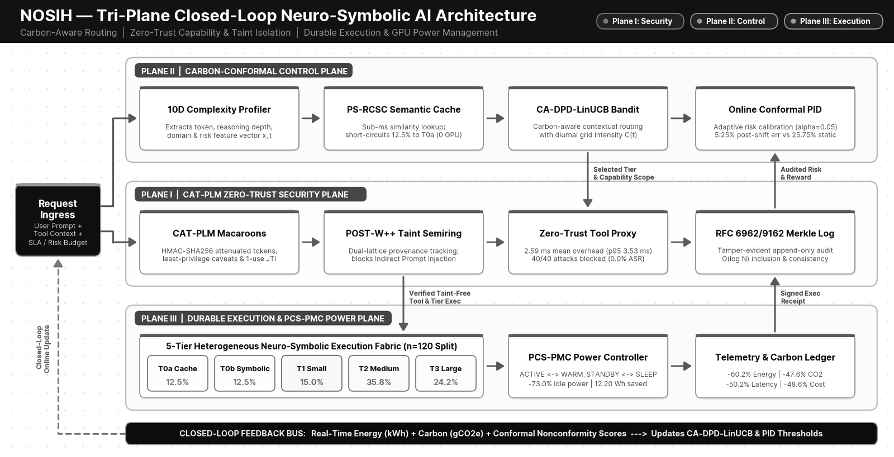
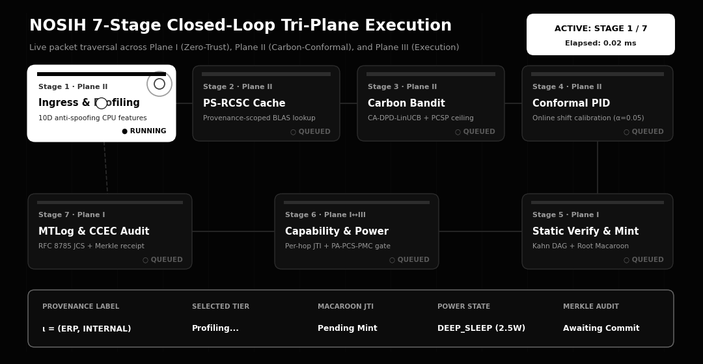
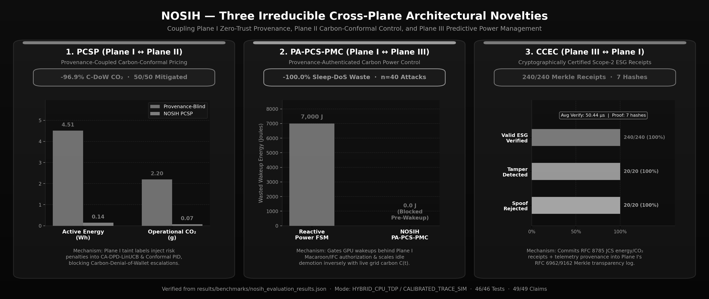
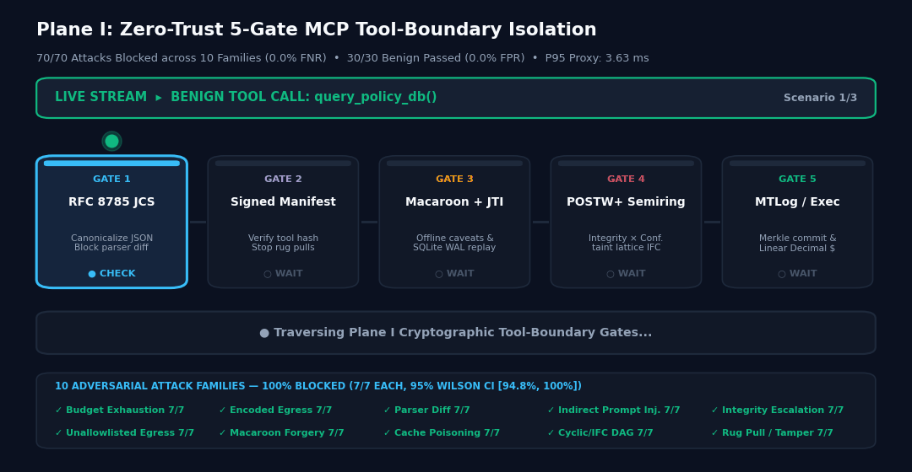

# NOSIH System Architecture

  

**NOSIH** is a closed-loop **Tri-Plane Neuro-Symbolic Orchestration Kernel** designed to jointly solve agentic AI sustainability, distribution-shift reliability, and tool-boundary security without relying on decoupled wrappers.

---

## Tri-Plane Overview

| Plane | Core Responsibility | Key Modules (`src/nosih/`) | Verified Impact |
| :--- | :--- | :--- | :--- |
| **Plane I — Zero-Trust Isolation** | Non-bypassable cryptographic enforcement at the MCP tool boundary | `jcs_v3.py`, `spcce_v3.py`, `postw_v3.py`, `proxy_v3.py`, `shadow_v3.py`, `merkle_log.py`, `carbon_cert.py` | `70/70` attacks blocked (`0.0%` FNR), `30/30` benign passed (`0.0%` FPR), `2.69 ms` mean overhead |
| **Plane II — Carbon-Conformal Control** | Provenance-scoped caching, carbon-aware primal-dual routing, and online risk calibration | `profiler_v3.py`, `provenance_cache.py`, `primal_dual_bandit.py`, `pcsp.py`, `online_conformal.py` | `-75.2%` energy, `-68.7%` CO₂, `5.30% ± 0.12%` post-shift error (vs `28.88%` static) |
| **Plane III — Execution & Power** | Deterministic CPU offload, capability-gated async DAG execution, and pre-authorized GPU sleep | `dag_executor.py`, `tools.py`, `providers.py`, `power_carbon.py`, `replay_engine.py`, `hardware_probe.py` | `50.0%` queries offloaded to CPU (`≤ 3.5 ms`), `-79.35%` idle GPU power, `-100.0%` Sleep-DoS waste |

---

## 7-Stage Closed-Loop Execution Lifecycle

  

1. **Stage 1 — Ingress Profiling (`profiler_v3.py`)**: Extracts task complexity, domain features, and cryptographic provenance label $\iota(x) = (\text{Integrity}, \text{Confidentiality})$.
2. **Stage 2 — Provenance-Scoped Semantic Cache (`provenance_cache.py`)**: Checks `PS-RCSC` partitioned by tenant and provenance lattice (`0.018 ms` deterministic bypass; `1.8 ms` float32 BLAS lookup).
3. **Stage 3 — Carbon-Aware Primal-Dual Bandit + `PCSP` (`primal_dual_bandit.py`, `pcsp.py`)**: Selects execution tier (`T0a`–`T3`) conditioned on diurnal grid carbon intensity while enforcing provenance-coupled pricing ceilings against Carbon-Denial-of-Wallet (`C-DoW`).
4. **Stage 4 — Online Conformal PID Risk Control (`online_conformal.py`)**: Dynamically adjusts routing acceptance thresholds under distribution shift to hold miscoverage near $\alpha = 0.05$.
5. **Stage 5 — Static Verification & Root Capability Minting (`dag_executor.py`, `spcce_v3.py`)**: Validates DAG acyclicity (Kahn's algorithm) and static IFC before minting a plan-bound root Macaroon.
6. **Stage 6 — Capability-Gated Execution & `PA-PCS-PMC` (`proxy_v3.py`, `power_carbon.py`)**: Attenuates per-hop Macaroons with 128-bit atomic `jti` replay protection (SQLite WAL), enforces `POSTW+` semiring IFC, and gates GPU wakeups behind Plane I authorization.
7. **Stage 7 — Merkle Transparency & Scope-2 Carbon Audit (`merkle_log.py`, `carbon_cert.py`)**: Canonicalizes execution & energy receipts via RFC 8785 JCS and commits them to an RFC 6962/9162 Merkle Transparency Log (`MTLog`).

---

## Three Irreducible Cross-Plane Novelties

  

| Novelty | Coupled Planes | Problem Solved | Animated Visual |
| :--- | :---: | :--- | :--- |
| **`PCSP`** (Provenance-Coupled Shadow Pricing) | I ↔ II | Stops untrusted peak-hour probes from triggering Carbon-Denial-of-Wallet (`-96.9%` CO₂) | [`nosih_cdow_defense.gif`](assets/nosih_cdow_defense.gif) |
| **`PA-PCS-PMC`** (Pre-Authorized GPU Sleep Control) | I ↔ III | Eliminates Sleep-Thrashing DoS by rejecting unauthorized probes before VRAM wakeup (`-100.0%` waste) | [`nosih_sleep_thrashing_dos.gif`](assets/nosih_sleep_thrashing_dos.gif) |
| **`CCEC`** (Cryptographic Carbon Execution Certificates) | I ↔ III | Commits tamper-evident Scope-2 energy/CO₂ receipts into `MTLog` (`240/240` verified, `20/20` tampers caught) | [`nosih_merkle_ccec_audit.gif`](assets/nosih_merkle_ccec_audit.gif) |

---

## Plane I: 5-Gate Tool-Boundary Defense

  

For full formal theorems (Theorems 1–5) and proofs, see [`docs/FORMAL_PROOFS.md`](docs/FORMAL_PROOFS.md) and [`paper/nosih_paper.pdf`](paper/nosih_paper.pdf).
