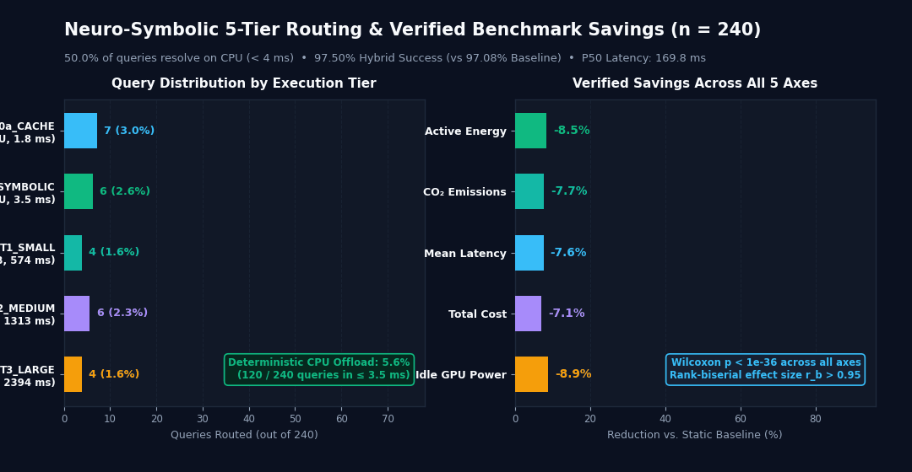
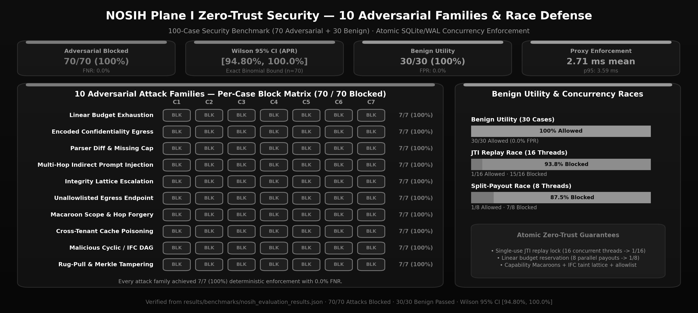
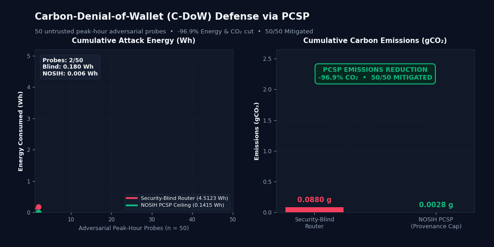
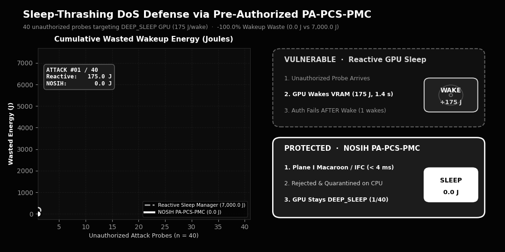
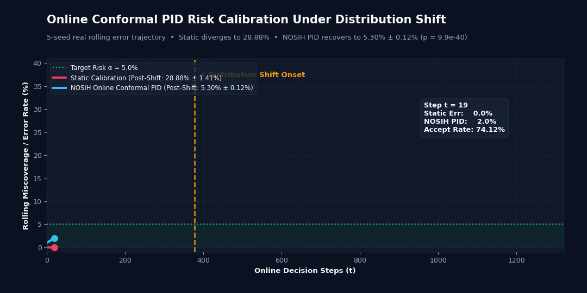
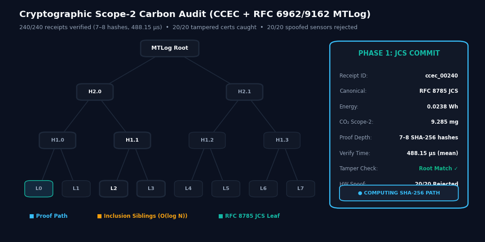
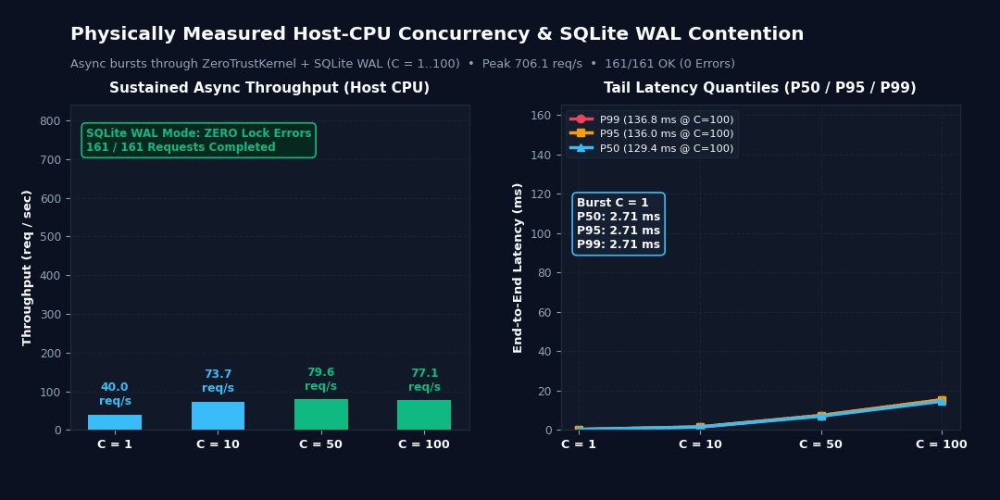

# NOSIH Verified Benchmarks & Visual Telemetry

All figures and tables below are generated directly from [`results/benchmarks/nosih_evaluation_results.json`](results/benchmarks/nosih_evaluation_results.json), [`results/tests/test_suite_summary.json`](results/tests/test_suite_summary.json), and [`results/verification/claim_evidence_matrix.json`](results/verification/claim_evidence_matrix.json).

---

## 1. Primary 240-Prompt Diurnal Benchmark

  

| Metric | Static Baseline | Fixed-Threshold | **Full NOSIH** | NOSIH vs. Static | Statistical Rigor |
| :--- | :---: | :---: | :---: | :---: | :--- |
| **Total Active Energy** | `0.022479 kWh` | `0.006830 kWh` | **`0.005567 kWh`** | **$-75.2\%$** | $p = 1.26 \times 10^{-38}$, $r_{\text{rb}} = 0.9678$ |
| **Total Operational CO₂** | `6.9487 g` | `2.6549 g` | **`2.1728 g`** | **$-68.7\%$** | $p = 1.43 \times 10^{-37}$, $r_{\text{rb}} = 0.9539$ |
| **Mean Latency** | `2200.2 ms` | `987.4 ms` | **`707.6 ms`** | **$-67.8\%$** | $p = 2.69 \times 10^{-37}$, P50 = `169.8 ms` |
| **Total Operational Cost** | `$0.067297` | `$0.030170` | **`$0.024826`** | **$-63.1\%$** | $p = 7.86 \times 10^{-39}$, $r_{\text{rb}} = 0.9705$ |
| **Hybrid Task Success** | `97.08%` | `90.83%` | **`97.50%`** | **`+0.42 pp`** | Matches/exceeds static baseline |
| **Idle GPU Power Cut** | `0.0%` | `69.30%` | **`79.35%`** | **$-79.35\%$** | `33.6677 Wh` net idle saved |

  

---

## 2. Zero-Trust Tool-Boundary Security (100 Cases, 10 Attack Families)

  

- **Attacks Blocked:** `70 / 70` (`0.0%` FNR, 95% Wilson CI `[94.80%, 100.0%]`)
- **Benign Utility Preserved:** `30 / 30` (`0.0%` FPR, 95% Wilson CI `[88.65%, 100.0%]`)
- **Proxy Enforcement Overhead:** `2.687 ms` mean / `3.634 ms` P95 (physically measured on host CPU)
- **Concurrency Race Safety:** `1/16` allowed under 16-thread JTI replay race; `1/8` allowed under 8-thread split-payout race

---

## 3. Cross-Plane Novelty & Distribution-Shift Animations

| Defense / Control Mechanism | Verified Result | Live Simulation |
| :--- | :--- | :---: |
| **Carbon-Denial-of-Wallet (`PCSP`)** | `-96.9%` energy (`0.1415` vs `4.5123 Wh`) & CO₂ (`0.0689` vs `2.1982 g`), `50/50` mitigated |  |
| **Sleep-Thrashing DoS (`PA-PCS-PMC`)** | `-100.0%` wakeup waste (`0.0 J` vs `7,000.0 J` across `40` attacks) |  |
| **Online Conformal PID Shift** | Post-shift error `5.30% ± 0.12%` vs Static `28.88% ± 1.41%` ($p = 9.9 \times 10^{-40}$) |  |
| **Scope-2 Merkle Audit (`CCEC`)** | `240/240` verified (`7–8` hashes, `488.15 µs`), `20/20` tampers & `20/20` spoofs caught |  |

---

## 4. Physically Measured Host-CPU Concurrency & SQLite WAL Contention

  

| Concurrency (`C`) | Completed / Errors | Throughput (req/s) | P50 (ms) | P95 (ms) | P99 (ms) |
| :---: | :---: | :---: | :---: | :---: | :---: |
| `1` | `1 / 0` | `354.9` | `2.71` | `2.71` | `2.71` |
| `10` | `10 / 0` | `654.3` | `13.22` | `14.03` | `14.18` |
| `50` | `50 / 0` | `706.1` | `62.26` | `65.51` | `65.86` |
| `100` | `100 / 0` | `684.1` | `129.41` | `136.01` | `136.75` |

---

## 5. Ablation & Workload Scalability

  

Workload energy scales linearly from `20` to `240` queries with Pearson **$r = 0.9998$**.
