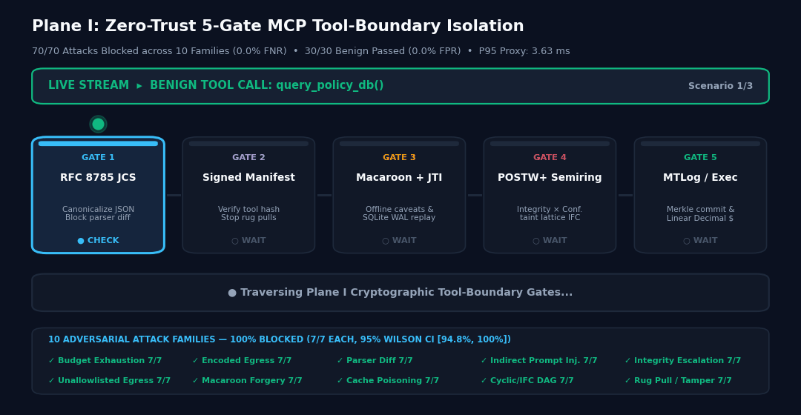

# Formal Security Threat Model & Trust Boundaries

  

This document defines the adversary model, cryptographic trust boundaries, enforced invariants, and explicit out-of-scope boundaries for **NOSIH Plane I (Zero-Trust Isolation)** and its cross-plane couplings (**`PCSP`**, **`PA-PCS-PMC`**, **`CCEC`**).

---

## 1. Security Objectives

1. **Non-Bypassable Tool-Boundary Isolation:** No probabilistic LLM planner or untrusted external document can invoke a privileged MCP tool without passing all 5 Plane I gates.
2. **Monotonic Capability Attenuation & Single-Use Consumption:** Per-hop capabilities can only narrow privileges (never escalate) and cannot be replayed—even under concurrent multi-threaded races.
3. **Algebraic Information Flow Control (IFC):** Untrusted inputs cannot drive high-integrity sinks, and confidential data cannot egress to unallowlisted or lower-clearance endpoints (including Base64/hex encoded exfiltration).
4. **Exact Linear Monetary & Resource Budgets:** Concurrent tool calls cannot overspend monetary budgets via floating-point rounding or TOCTOU split-payout races.
5. **Cross-Plane Resource-Exhaustion Defense:** Untrusted inputs cannot force high-carbon peak-hour GPU routing (`C-DoW`) or wake sleeping GPUs before authorization (`Sleep-Thrashing DoS`).
6. **Tamper-Evident Transparency:** Every tool decision, quarantine event, and Scope-2 energy receipt is canonicalized (RFC 8785 JCS) and committed to an append-only RFC 6962/9162 Merkle Transparency Log (`MTLog`).

---

## 2. Adversary Model

| Adversary Class | Capabilities Assumed | Mitigated By |
| :--- | :--- | :--- |
| **Indirect Prompt Injector** | Embeds arbitrary adversarial instructions inside retrieved web pages, emails, PDFs, or RAG chunks | `POSTW+` Integrity × Confidentiality semiring (`postw_v3.py`) + static DAG IFC (`dag_executor.py`) |
| **Compromised / Malicious Planner** | Attempts to invoke unapproved tools, forge arguments, alter JSON serialization, or construct cyclic DAGs | RFC 8785 JCS (`jcs_v3.py`), Signed Tool Manifests (`proxy_v3.py`), Kahn DAG verifier (`dag_executor.py`) |
| **Malicious MCP Tool Server (Rug Pull)** | Mutates tool schema or description post-approval to hijack arguments | Cryptographic manifest digest binding (`proxy_v3.py`) |
| **Concurrent Replay / Race Attacker** | Replays a captured Macaroon across 16 parallel threads or splits a payout across 8 threads to bypass budget caps | Atomic SQLite WAL `jti` replay store (`spcce_v3.py`) + exact `decimal.Decimal` linear locks |
| **Cross-Tenant Cache Poisoner** | Seeds malicious semantic cache entries to hijack responses for another tenant or higher-integrity context | `PS-RCSC` tenant + provenance lattice partitioning (`provenance_cache.py`) |
| **Sustainability / Resource Attacker** | Floods peak-carbon hours with untrusted probes (`C-DoW`) or pings sleeping GPUs with unauthorized requests (`Sleep-DoS`) | `PCSP` provenance ceiling (`pcsp.py`) + `PA-PCS-PMC` pre-authorized sleep gating (`power_carbon.py`) |

---

## 3. Trust Assumptions & TCB Boundary

- **Trusted Computing Base (TCB):** The NOSIH host kernel process (`ZeroTrustKernel`), local HMAC-SHA256 secret provider (`StrictSecretProvider`), SQLite WAL state files, and OS process isolation are assumed uncompromised.
- **Untrusted Components:** All external prompts, retrieved documents, LLM outputs/plans, third-party MCP tool responses, and unverified network endpoints are treated as untrusted.
- **CCEC Scope-2 Trust Clarification:** `CarbonCertificateAuthority` (`carbon_cert.py`) guarantees tamper-evident, Merkle-auditable accounting records under the host TCB (`240/240` verified, `20/20` tampers caught, `20/20` spoofs rejected). Protecting sensor readings against a root-compromised host requires hardware TEE attestation (e.g., Intel TDX / NVIDIA Confidential Computing), which is explicitly tracked on the [`ROADMAP.md`](ROADMAP.md).

---

## 4. Ten Adversarial Attack Families — Verified Coverage

All 10 families (`7` cases each = `70` attacks) plus `30` benign control workflows are continuously tested:

| # | Attack Family | Primary Defense Gate | Result |
| :-: | :--- | :--- | :---: |
| 1 | Linear Budget Exhaustion & Split-Payout Race | Exact `Decimal` linear budget + atomic lock | `7 / 7` Blocked |
| 2 | Encoded Confidentiality Egress (Base64/Hex) | `POSTW+` confidentiality clearance + egress scanner | `7 / 7` Blocked |
| 3 | JSON Parser Differential & Missing Capability | RFC 8785 JCS canonicalization + mandatory Macaroon | `7 / 7` Blocked |
| 4 | Multi-Hop Indirect Prompt Injection | `POSTW+` taint propagation across DAG hops | `7 / 7` Blocked |
| 5 | Integrity Lattice Escalation (Bank/Master Mutation) | Strict $\iota(\text{arg}) \le \iota_{\text{req}}$ sink check | `7 / 7` Blocked |
| 6 | Unallowlisted Egress Endpoint | Signed endpoint allowlist & reader set check | `7 / 7` Blocked |
| 7 | Macaroon Scope & Hop Forgery | HMAC-SHA256 chained caveat verification | `7 / 7` Blocked |
| 8 | Cross-Tenant Semantic Cache Poisoning | `PS-RCSC` tenant & provenance-lattice keys | `7 / 7` Blocked |
| 9 | Malicious Cyclic or IFC-Violating DAG | Static Kahn acyclicity + IFC pre-execution verifier | `7 / 7` Blocked |
| 10 | Tool Schema Rug Pull & Merkle Log Tampering | Signed manifest hash + RFC 6962/9162 consistency proof | `7 / 7` Blocked |

---

## 5. Explicitly Out of Scope

- **Semantic-only jailbreaks with zero tool invocation:** NOSIH enforces architectural tool-boundary isolation, not natural-language content moderation of pure text completions.
- **Physical side-channel attacks (Spectre/Rowhammer/EM) or compromised host OS kernels.**
- **Availability against volumetric L3/L4 network DDoS upstream of the orchestration kernel.**

To report a security vulnerability, follow the coordinated disclosure policy in [`SECURITY.md`](SECURITY.md).
